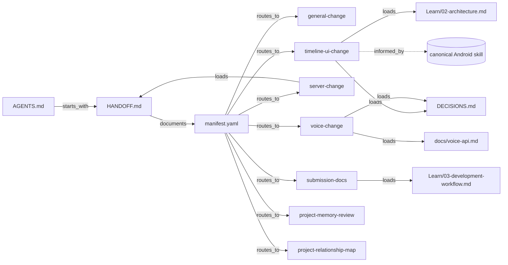
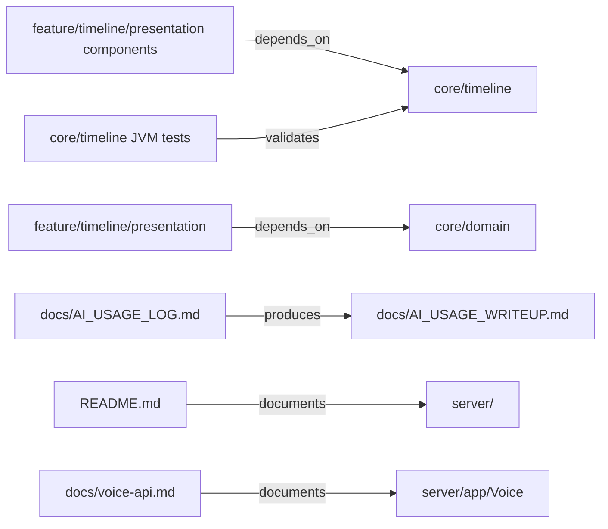

# Project Relationship Map

An orientation layer, read on demand. The query-backed source of truth is [`project-relationships.tsv`](project-relationships.tsv). Query it rather than reading it in full:

```sh
sh scripts/query-relationship-map.sh --edge-file project-relationships.tsv --from task:timeline-ui-change
sh scripts/query-relationship-map.sh --edge-file project-relationships.tsv --relation validates
```

## AI Context Flow



## Code Dependencies



Relations used: `starts_with`, `documents`, `routes_to`, `loads`, `informed_by`, `depends_on`, `validates`, `produces`, `reviews`, `guards`.
